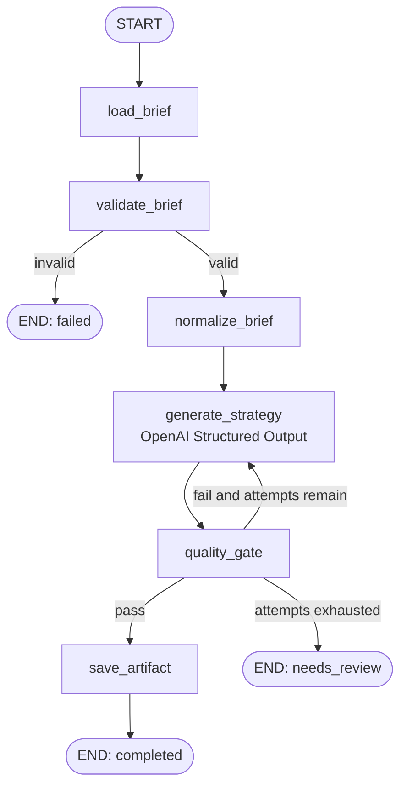

# Overview terminal strategy workflow

## Outcome

Given a JSON campaign brief, the application validates it, asks OpenAI for a typed strategy,
checks business invariants, retries a weak result within a fixed budget, saves an approved JSON
artifact, and checkpoints every graph step in SQLite.



## Why each boundary exists

- Pydantic validates shape and field constraints before and after an LLM call.
- `StrategyGenerator` prevents OpenAI SDK types from leaking into graph nodes.
- The deterministic quality gate verifies cross-field facts such as campaign ID, objective, CTA,
  mandatory elements, and blocking risks.
- `thread_id` identifies a checkpoint history. It is operational state, not a campaign ID.
- The artifact store uses an atomic replace so a crash cannot leave a half-written JSON result.
- `store=False` disables provider-side response storage for this request. LangGraph's local
  checkpoint remains the workflow system of record.

## Practice sequence

1. Read `domain/brief.py` and change one validation constraint; run the domain tests.
2. Read `graph/state.py`, then trace which node owns each field.
3. Add a deterministic rule to `quality_gate.py` and a test that proves its retry behavior.
4. Change only `prompts/strategy_v1.md`; compare artifact quality across two thread IDs.
5. Add token cost estimation to generation metadata without importing OpenAI into a graph node.

## Commands

```powershell
poster-agent doctor
poster-agent brief validate examples/campaign_brief.json
poster-agent campaign run examples/campaign_brief.json --max-attempts 2
poster-agent campaign inspect <thread-id>
poster-agent campaign resume <interrupted-thread-id>
```

Do not reuse a finished `thread_id` for a different brief. A new campaign execution should get a
new thread ID; inspection and an explicit future resume command should reuse an existing one.

## Definition of done

- Invalid input never calls the model.
- Model output is a `CampaignStrategy`, not an unvalidated string or ad-hoc JSON.
- Quality retry is bounded and visible in `generation_attempt`.
- A successful run has status `completed` and a readable artifact path.
- The latest state can be read after restarting the CLI.
- Ruff, mypy, and pytest pass without an external API call.
