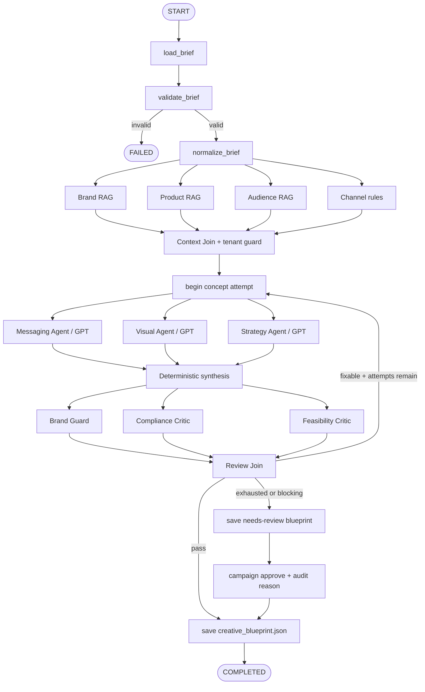

# RAG and multi-parallel workflow

This instruction turns a campaign brief plus tenant-scoped enterprise documents into a reviewed
`CreativeBlueprint`. The current terminal adapter stores embeddings in SQLite and performs cosine
ranking in application code. Ports allow a later pgvector or managed vector database adapter
without changing graph nodes.

## Run order

```powershell
poster-agent brand ingest examples\brand\acme-coffee `
  --tenant-id demo-company `
  --brand-id acme-coffee `
  --brand-name "Acme Coffee"

poster-agent campaign run examples\campaign_brief.json --max-attempts 2
```

## A. Implemented brand ingestion flow

```mermaid
flowchart LR
    S([START]) --> D[discover supported files]
    D --> P[parse MD / TXT / JSON / PDF]
    P --> C[normalize and chunk]
    C --> E[OpenAI embeddings in batches]
    E --> I[index SQLite by tenant + brand + document]
    I --> R[semantic retrieval for profile evidence]
    R --> B[OpenAI BrandProfile Structured Output]
    B --> SP[save scoped BrandProfile]
    SP --> X([READY])
```



Every stored chunk contains `tenant_id`, `brand_id`, `document_id`, `chunk_id`, `source_version`,
`source_path`, text, and embedding. Retrieval SQL always filters tenant and brand before ranking.

## B. Implemented campaign graph



## Parallel state ownership

| Branch | State key |
|---|---|
| Brand RAG | `brand_profile`, `brand_evidence` |
| Product RAG | `product_evidence` |
| Audience RAG | `audience_evidence` |
| Channel rules | `channel_guidance` |
| Messaging agent | `messaging_proposal` |
| Visual agent | `visual_proposal` |
| Strategy agent | `strategy_proposal` |
| Brand guard | `brand_review` |
| Compliance critic | `compliance_review` |
| Feasibility critic | `feasibility_review` |

Only join nodes combine branches. `generation_metadata` uses an explicit LangGraph list reducer,
because all three concept agents write metadata in the same parallel super-step.

## Inputs

- `CampaignBrief` including `tenant_id` and `brand_id`.
- Indexed enterprise documents for the same tenant and brand.
- BrandProfile synthesized during ingestion.
- OpenAI text and embedding model configuration.

### Dynamic supporting copy

`CampaignBrief.headline` can lock the campaign headline, while `support_copy_policy` gives the
Messaging Agent a bounded content budget. The agent generates supporting messages from retrieved
evidence instead of requiring exact support sentences in `mandatory_elements`. Compliance review
checks the item count, word budget, exact headline, and exact CTA before approval.

## Output

`creative_blueprint.json` contains:

- original validated brief;
- messaging, visual, and strategy proposals;
- retrieved evidence with source and version;
- BrandProfile;
- three automated review reports;
- human approval record when applicable;
- response IDs and token usage for each GPT specialist;
- final status (`completed` or `needs_review`).

