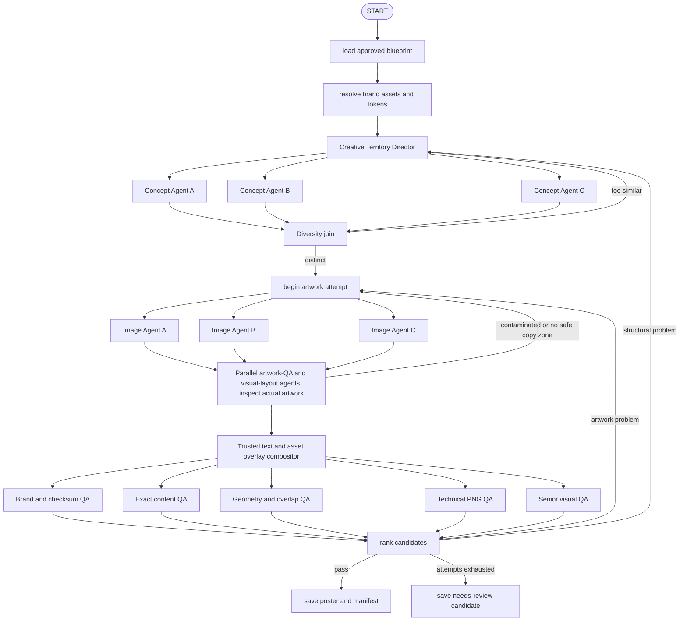

# Sprint 3.5 — autonomous creative composition

Sprint 3.5 consumes an approved Sprint 2 `creative_blueprint.json` and the brand's exact asset
manifest. It has no campaign layout templates or hard-coded poster coordinates.

The design model decides the creative metaphor, hierarchy, artwork, typography treatment, and
normalized positions. Trusted application code validates that Scene Graph and renders exact copy,
approved assets, and the original logo.

## Workflow



## What is autonomous

- The director creates three campaign-specific creative territories.
- The same generic Concept Agent executes each territory in parallel.
- Each agent chooses normalized layer bounds, hierarchy, font family, weight, style, text scale,
  line spacing, horizontal and vertical alignment, text transform, whitespace, support-copy
  selection, and whether to use the approved product asset.
- Image Agents may create products, conceptual UI, people, environments, diagrams, symbols, and
  recognizable objects. They own the complete visual artwork, including its background, panels,
  connection lines, icons, surfaces, and decorative geometry.
- After generation, three visual-layout agents inspect their actual variant in parallel. They move
  the logo and exact copy into visible negative space, away from faces, hero objects, meaningful UI,
  focal highlights, and the main visual path.
- Visual-layout agents independently choose font family, weight, size, italic style, alignment,
  line spacing, base color, and selective accent-word color. This makes typography image-driven
  and prevents all concepts from collapsing into the same black-headline/blue-CTA treatment.
- Approved reference posters inform upstream RAG and creative direction. They are not passed to
  image editing, preventing direct layout, logo, text, name, metric, testimonial, or UI copying.

## What remains locked

- `locked_logo` always loads the approved manifest asset and is composited last.
- The logo source checksum is recorded and verified by Brand QA.
- Logo recolor, rotation, crop, perspective distortion, and regeneration are unavailable.
- Brand colors are anchor colors, not an exclusive palette. Concept agents may introduce deliberate
  hexadecimal accent colors.
- A supplied official font remains available as `brand`; otherwise concept agents may choose from
  the supported professional system-font families.
- Headline and CTA are taken from the approved campaign data.
- Supporting copy must first be generated and approved by Sprint 2 from RAG evidence.
- Scene layers must remain inside the canvas and foreground layers may not overlap.
- Composition preserves the generated candidate as the visible key visual. It overlays only exact
  copy, the approved logo, and an optional approved product asset; old checkpoint shape layers are
  ignored so they cannot repaint the generated artwork.
- The initial Scene Graph is provisional. Final overlay coordinates and typography are authored
  only after a vision-capable layout agent has inspected the generated image.

These are invariants and quality gates, not visual templates.

The logo is the only visually locked asset. Exact campaign copy remains source-controlled so image
generation cannot misspell or invent claims, but its font, scale, case, alignment, spacing, and
placement are selected by the concept agent.

## Brand tokens

An asset manifest may define exact identity tokens:

```json
{
  "brand_tokens": {
    "colors": {
      "brand_blue": "#2463EB",
      "brand_purple": "#A020F0",
      "ink": "#090B18",
      "white": "#FFFFFF"
    },
    "gradients": [["#2463EB", "#A020F0"]],
    "heading_font_asset_id": null,
    "body_font_asset_id": null,
    "minimum_logo_width_ratio": 0.12,
    "logo_clear_space_ratio": 0.025
  }
}
```

Replace inferred colors with official values when the company supplies its formal guideline.

The logo is required. An approved product image is optional: concept agents can instead request a
generated product, UI, or symbolic visual inside the artwork layer.

Artwork rejected by QA is never silently replaced with a generic gradient. When artwork attempts
are exhausted, the original candidate is composed and saved as `needs_review` with its failed QA
reports intact. This preserves creative work and makes the review trail truthful.

## Copy freedom

Campaign briefs may lock a headline while allowing the messaging agent to generate grounded
support copy:

```json
{
  "headline": "Stop searching. Start connecting.",
  "support_copy_policy": {
    "min_items": 1,
    "max_items": 4,
    "max_words_per_item": 12,
    "allowed_angles": ["creator discovery", "campaign collaboration"],
    "must_be_grounded_in_rag": true
  }
}
```

Do not put exact supporting sentences in `mandatory_elements` when you want the Copy Agent to
create them.

## Configuration

```dotenv
OPENAI_API_KEY=your_project_api_key
OPENAI_MODEL=your_structured_output_and_vision_model
OPENAI_IMAGE_MODEL=gpt-image-2.5-flare
POSTER_VARIANT_COUNT=3
POSTER_MAX_RENDER_ATTEMPTS=2
POSTER_QA_THRESHOLD=75
POSTER_GENERATION_SIZE=1088x1360
POSTER_GENERATION_QUALITY=high
```

`1088x1360` has the same 4:5 aspect ratio as the final 1080×1350 poster and prevents composition
cropping between image generation and final rendering.

## Run

Create a new approved blueprint after changing the brief, then validate and render it:

```cmd
poster-agent campaign run examples\brands\kollab\briefs\stop-searching-start-connecting.json --max-attempts 2
poster-agent render validate "PATH_TO_NEW_CREATIVE_BLUEPRINT.json" --assets examples\brands\kollab\assets\asset_manifest.json
poster-agent render run "PATH_TO_NEW_CREATIVE_BLUEPRINT.json" --assets examples\brands\kollab\assets\asset_manifest.json --variants 3 --max-attempts 2
```

One three-variant render performs one director Structured Output call, up to three parallel concept
Structured Output calls, then one image/edit call, artwork vision call, and final vision call per
enabled candidate and artwork attempt.

## Output

```text
artifacts/<campaign_id>/<thread_id>/renders/<render_id>/
├── generated/attempt-*/variant-*.png
├── composed/attempt-*/variant-*.png
├── final/poster.png
├── needs_review/poster.png
└── render_manifest.json
```

`render_manifest.json` now stores the complete dynamic `render_plan`, including the territories,
Scene Graphs, diversity result, layout signatures, exact asset hashes, QA reports, and selection.
